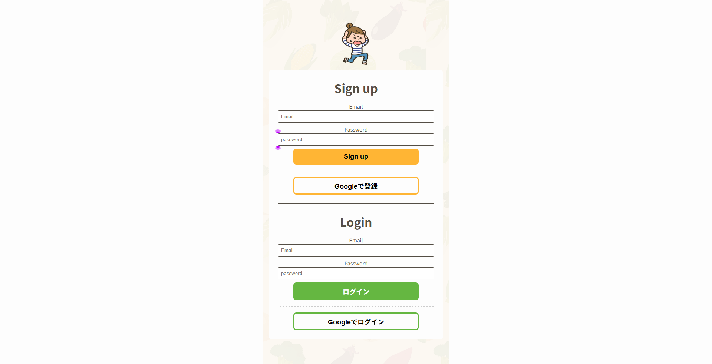
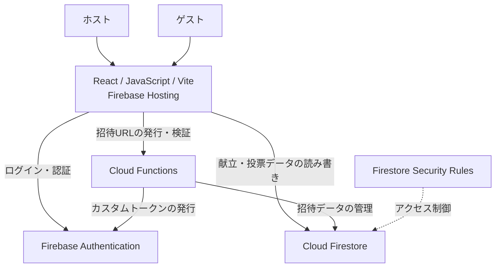

# だれか決めて！晩ごはん

家族や友人と「今日のごはん、何にする？」を楽しく決められる献立投票アプリです。

ホスト（作る人）が献立を管理し、ゲスト（家族や友人）が投票することで、毎日の献立決めをスムーズに行えます。投票結果だけでなく、自動献立生成や買い物リスト作成にも対応しており、献立作成から買い物までを一つのアプリで完結できます。

### デモ

---

## 概要

栄養士として働いていた経験から、「毎日の献立を考えること」は想像以上に負担が大きいと感じていました。

家族の好みや冷蔵庫の食材、買い物の予定など、さまざまな条件を考えながら献立を決めても、「今日はそれじゃない」と言われることも少なくありません。

そこで、「みんなで投票して決められたら、献立決めがもっと楽しくなるのではないか」という発想から本アプリを開発しました。

投票によって家族全員の意見を反映しながら献立を決定し、さらに自動献立生成や買い物リスト機能によって、日々の献立作成の負担を軽減することを目的としています。

本リポジトリは、公開中のアプリを題材に、コードの可読性や保守性を考慮して整理した学習・ポートフォリオ用のコードです。

公開中のアプリと一部実装が異なる場合があります。

---

## 主な機能

- ホストアカウント作成・ログイン（Firebase Authentication）
- 献立・材料の登録、編集
- ゲスト招待URLの発行
- ゲストによる献立投票
- 投票結果を考慮した1週間分の献立自動生成
- 買い物リスト自動生成
- 材料入力オートコンプリート
- 献立・材料編集機能

---

## 使用技術

| 分類 | 技術 |
| --- | --- |
| フロントエンド | React / Vite |
| データベース | Firestore |
| 認証 | Firebase Authentication |
| サーバー | Firebase Cloud Functions |
| ホスティング | Firebase Hosting |
| 状態管理 | React Hooks |
| 入力補助 | wanakana |
| 開発言語 | JavaScript（TypeScript対応予定） |

---
## システム構成

フロントエンドにはReactを使用し、Firebase Hostingで公開しています。

認証にはFirebase Authentication、データ管理にはCloud Firestoreを使用しています。

招待URLの発行・検証やカスタムトークンの発行はCloud Functionsで行い、Firestore Security Rulesによってクライアントからのデータアクセスを制御しています。

---

## 技術選定理由

### React

SPAによる快適な画面遷移とコンポーネント単位での開発が行えるため採用しました。

### Firebase

フロントエンドの学習に集中することを目的とし、バックエンドを一から構築する代わりにFirebaseを採用しました。

認証・データベース・Cloud Functions・Hostingまでを一つのサービスで利用できるため、短期間でアプリを完成させることができました。

---

## 工夫したポイント

### 技術面

- Firebase Authentication・Firestore・Cloud Functionsを利用したサーバーレス構成
- Cloud Functionsを利用した招待URLの発行・検証とカスタムトークン認証
- Firestoreのコレクションを役割ごとに分離し、Security Rulesによるアクセス制御を実装
- Firebase Emulatorを利用し、本番環境へ影響を与えずに開発・検証を実施

### UI / UX

- スマートフォンで操作しやすいシンプルな画面構成
- 材料入力時にオートコンプリートを導入し入力負担を軽減
- 買い物リストをチェックリスト形式で管理
- 初回設定を途中保存し、途中離脱後も続きから設定を再開可能
- 投票済みメニューを視覚的に判別できるUIを実装

### セキュリティ

- Firestore Security Rulesによるアクセス制御
- ホスト・ゲスト・サーバーの役割に応じたアクセス権限の設定
- 招待データへのクライアントからの直接アクセスを禁止
- Cloud Functionsによる招待コードの存在確認・有効期限・使用回数の検証
- 環境変数やSecret Managerを利用した設定値の管理

### 招待URLについて

本アプリは家族などの少人数での利用を想定しており、招待URLには3日間の有効期限と5回の使用回数上限を設定しています。

ゲストの参加負担を軽減するため、アカウント登録を不要とし、Firebaseのカスタムトークンによる認証を採用しました。

ゲストIDはローカルストレージで管理しているため、ローカルストレージの削除による再投票を完全に防止するものではありません。

また、招待コードの使用回数については、同時アクセス時の整合性確保を今後の改善課題としています。

---

## Firestore設計

データの役割ごとにコレクションを分割し、アクセス権限を明確にしています。

- 共通データ（メニュー・材料・オートコンプリート）
- ホスト専用データ
- ホスト・ゲスト共有データ（投票・週間献立）
- サーバー専用データ（招待トークン）

これによりSecurity Rulesをシンプルに保ちながら、安全なデータ管理を実現しています。

---

## 苦労したこと・学び

- Firestoreのデータ構造を途中で見直し、セキュリティを考慮した設計へ変更
- Firebase AuthenticationとCloud Functionsを利用した招待URL・カスタムトークン認証の実装
- Firebase Emulatorの環境構築
- APIキーの管理を見直した経験から、環境変数の利用や公開対象ファイルの確認、Gitによるソースコード管理の重要性を学んだ。

今回の開発を通して、実装だけでなく、設計やセキュリティを考慮した開発の重要性を学ぶことができました。

---

## 今後改善したいこと

### 技術面

- TypeScriptへの移行
- 招待コードの使用回数管理のトランザクション化
- ゲストの投票に関するアクセス制御の強化

### 機能面

- ログアウト機能の追加
- ホスト側での投票結果表示
- 通知機能の追加
- 副菜まで含めた献立提案
- レシピ・食材分量・料理画像の表示
- 過去の献立履歴管理
- UI / UXのさらなる改善

---

## ライセンス

本プロジェクトは個人学習を目的として開発しています。
